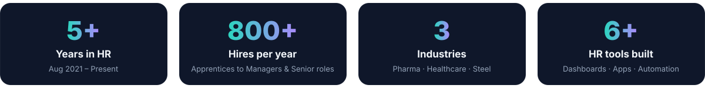

---

**ABOUT ME**
## People-first recruiter with a builder's mindset

I'm a **Talent Acquisition & HR professional** who hires across **all levels — from apprentices, trainees and technicians to managers and senior leadership roles**. I've also led **PAN-India high-volume hiring of ~800 apprentices every year**, built a candidate referral program, and moved apprentice hiring away from third-party agencies to direct recruitment — saving significant cost.

I also love making HR work smarter. I design and build my own **dashboards, letter generators and attendance systems** using Google Sheets, Apps Script and AI tools.

> 💡 *"Right people, right role, right time — backed by clean data."*

| 📍 Location | 💼 Experience | 🏭 Industries | 🎓 Education | 🗣️ Languages |
|:---:|:---:|:---:|:---:|:---:|
| Uttar Pradesh, India | 5 years (Aug 2021 – Present) | Pharma · Healthcare · Steel | B.Sc. · ITI (COPA) | Hindi · English · Kannada (basic) |

---

**EXPERIENCE**
## Professional journey
<i>From high-volume plant hiring to recruiting managers and senior professionals — and leading HR operations.</i>

<table>
<tr>
<td width="60"><h3>🏭</h3></td>
<td>

### Assistant Manager – Operations & Talent Acquisition (HR)
**Pharmaceutical manufacturing company** · Corporate office + manufacturing plant &nbsp;·&nbsp; `Feb 2026 – Present`

- 🎯 End-to-end recruitment for **all levels** — sales, CRM, corporate and plant roles, from staff to managers and senior positions (e.g. Production Chemist, QMS, AI Analyst); sourcing via Naukri.com, LinkedIn and job portals, screening and interviews with department heads
- 🧾 Onboarding cycle — documentation, joining formalities and induction
- ✉️ HR letters for both sites — offer, appointment, confirmation, experience and relieving
- 📊 **Digital HR & L&D** — built HR dashboards, an HR app and bilingual training assessments used to rewrite modules the whole team struggled with
- 🗂️ Employee records, HR databases and personnel files with accuracy and compliance
- ⏱️ Leave, attendance and employee data through internal HR systems
- 📐 Workforce planning and hiring-requirement analysis with department teams
- 📢 HR policy implementation and resolving employee queries

</td>
</tr>
<tr>
<td width="60"><h3>🩺</h3></td>
<td>

### Sr. Executive – Talent Acquisition (HR)
**Medical devices / healthcare company** &nbsp;·&nbsp; `Jul 2025 – Jan 2026`

- 🎯 Sourced and shortlisted candidates for technical, operational and managerial roles through Naukri.com and other portals
- 🧾 Onboarding, documentation and record maintenance across HR databases
- ⏱️ Leave and attendance management and day-to-day HR operations
- 🤝 Policy communication and coordination with departments
- ⚖️ **PF:** employee registrations, UAN generation & KYC, monthly ECR filing and challan payments
- 🏥 **ESIC:** registrations, monthly contribution filing and payments · **Labour Welfare Fund:** deductions, contributions and filings as per Haryana state rules
- 📁 Maintained statutory records and supported compliance audits

</td>
</tr>
<tr>
<td width="60"><h3>⚙️</h3></td>
<td>

### HR Officer & HR Trainee – Talent Acquisition (HR)
**Large integrated steel manufacturer** &nbsp;·&nbsp; `Aug 2021 – Jul 2025`

- 🚀 **HR Officer** `May 2023 – Jul 2025`: Led PAN-India recruitment of **~800 apprentices per year** under the Apprentices Act — joining, accommodation, induction, payroll, attendance, grievances, statutory compliance, government stipend reimbursement and training completion
- 🌱 **HR Trainee** `Aug 2021 – May 2023`: PAN-India trainee hiring, joining and induction, payroll and attendance, government stipend reimbursements
- 🏛️ **NAPS & NATS portals:** apprenticeship compliance, multi-stakeholder coordination and issue resolution

   

</td>
</tr>
</table>

---

**PROJECTS**
## HR tools I've designed & built
<i>Real tools used in day-to-day HR — built with Google Sheets, Apps Script, HTML/JavaScript and AI assistance.</i>

<table>
<tr>
<td width="50%" valign="top">

### 🧭 People Console
**Org Hierarchy & Workforce Analytics**

Live web app synced to Google Sheets, showing the whole organisation as an interactive hierarchy.

- ✅ Salary bands & payroll totals
- ✅ Span-of-control by manager
- ✅ Automatic data-quality checks

  

</td>
<td width="50%" valign="top">

### 📈 Training Performance Dashboard
**Analytics for a 34-member sales/CRM team**

Tracks every quiz and assessment with live refresh from Google Sheets.

- ✅ KPIs, leaderboard & watchlist
- ✅ Weakest-topic & score charts
- ✅ Per-employee exam drill-down

> **Impact:** led to rewriting training modules the whole team kept failing

  

</td>
</tr>
<tr>
<td width="50%" valign="top">

### 📝 Bilingual Training Assessments
**English + Hindi quizzes**

Built from **35 training-video transcripts** for sales and CRM teams.

- ✅ Test in preferred language
- ✅ Live 40-question certification exam
- ✅ Auto-scoring feeds the dashboard

 

</td>
<td width="50%" valign="top">

### ✉️ HR Letter Desk
**Automated HR letters**

One-page tool replacing manual letter drafting across multiple plants.

- ✅ Offer · Appointment · Confirmation
- ✅ Experience · Relieving letters
- ✅ Print-ready + Word download

 

</td>
</tr>
<tr>
<td width="50%" valign="top">

### ⏱️ Attendance & Leave System 
**Darwinbox-style app for ~150 staff**

Automates attendance from biometric punches through to payroll.

- ✅ Auto-sync from eSSL biometric
- ✅ Late / half-day rules applied
- ✅ Approvals + monthly payroll muster

  

</td>
<td width="50%" valign="top">

### 🔐 HR Self-Service Portal
**PIN login · role-based access**

Separate, secure views for employees, managers and HR admins — plus HR policies & induction material.

- ✅ Attendance & discipline policy
- ✅ Notice-board circulars
- ✅ New-joiner induction deck

 

</td>
</tr>
</table>

---

**FROM MY LINKEDIN**
## I write about HR, hiring & HR tech

> ### *"Most HR teams are already sitting on the data. The gap is usually one screen wide."*
> How a sales manager's corridor question — *"Which of my people need help, and with what?"* — became a training dashboard built on an existing Google Sheet. No vendor, no budget, no migration — and it showed which modules needed rewriting.

| 👥 Network | 🤖 Topics | 🎯 Hiring |
|:---:|:---:|:---:|
| 500+ connections · 700+ followers | AI in HR · People analytics | Regular job posts for sales, corporate & plant roles |

---

**ACHIEVEMENTS**
## Impact that mattered

<table>
<tr>
<td align="center" width="25%" valign="top"><h2>🥇</h2><b>Award for Exemplary Performance</b> Recognised for outstanding contribution to the organisation (2024)</td>
<td align="center" width="25%" valign="top"><h2>💰</h2><b>Removed Third-Party Agency</b> Moved apprentice hiring in-house — big cost savings and more control</td>
<td align="center" width="25%" valign="top"><h2>🤝</h2><b>Referral Program</b> Increased internal referrals and lowered recruitment costs</td>
<td align="center" width="25%" valign="top"><h2>🎓</h2><b>Campus Hiring</b> Annual drives across WB, Odisha, Bihar, UP & Karnataka</td>
</tr>
</table>

---

**SKILLS**
## What I bring

<table>
<tr>
<td width="33%" valign="top">

**🎯 Talent Acquisition**
- End-to-end Recruitment
- Leadership & Managerial Hiring
- High-volume / Apprentice Hiring
- Campus Recruitment
- Onboarding & Induction

</td>
<td width="33%" valign="top">

**⚙️ HR Operations & IR**
- Payroll, Leave & Attendance
- Statutory Compliance — PF, ESIC, LWF
- Grievance Handling & Engagement
- HR Policy Implementation

</td>
<td width="33%" valign="top">

**📊 HR Tech & Analytics**
- Advanced Excel
- HR Dashboards & Reporting
- Google Sheets & Apps Script
- AI Tools for HR

</td>
</tr>
</table>

**🛠️ Tools I use**

---

**EDUCATION**
## Education & certifications

<table>
<tr>
<td width="50%" valign="top">

`2019` &nbsp;**Bachelor of Science** CSJM University

`2017` &nbsp;**ITI – Computer Operator & Programming Assistant** Govt. Industrial Training Institute

**Certifications: CCC · ADCA** Course on Computer Concepts · Advanced Diploma in Computer Applications

</td>
<td width="50%" valign="top">

`Sep 2026 · Anthropic` 
**🤖 Claude Academy — AI Certifications** 
Verified course-completion credentials in applying AI to real work

  

</td>
</tr>
</table>

🏐 **Beyond work:** Volleyball · Cricket · Travelling

---

 

